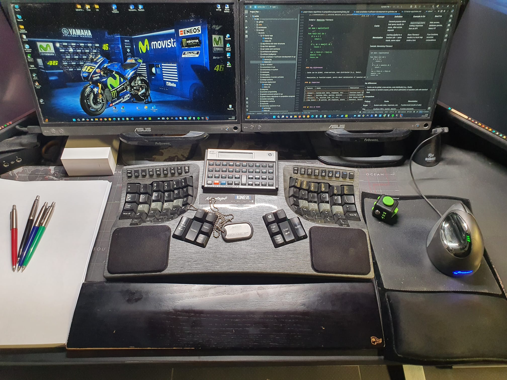

Hi, I'm **Norbert Jakubczak** — aka **Norbix** 👋

<figure style="max-width: 500px; margin: 1rem 0;">
  
  <figcaption style="text-align: center; font-style: italic; color: var(--secondary);">
    Building software. Chasing horizons.
  </figcaption>
</figure>

**Software Engineer | Technology Partner**  
Distributed Systems · NextGen SaaS & IoT · Go · Python · TypeScript

I help companies design, build, and evolve **distributed systems, cloud-native SaaS products, and NextGen IoT solutions**. My work combines hands-on software development with architecture, engineering quality, and the practical demands of production.

My primary focus is backend engineering with **Go, Python, and TypeScript**. My background in AWS, Kubernetes, and platform engineering helps me connect application design with how software is deployed, observed, and operated.

My **NextGen IoT development** work connects devices, SDKs, and cloud services into dependable software systems. I build device communication layers, integrate protocols, and develop backend services for device settings and data, with a focus on reliable messaging and observable behaviour across the full communication path.

I care about clear interfaces, maintainable code, security, and understanding how systems behave when things go wrong. The goal is software that solves a real problem and remains dependable as it grows.

Before moving into technology, I was a **professional basketball player**. That experience shaped how I work: preparation, discipline, teamwork, and taking responsibility under pressure.

> “Never say never, because limits, like fears, are often just an illusion.”
> — **Michael Jordan**

[Watch Michael Jordan's 2009 Hall of Fame speech](https://www.youtube.com/watch?v=U0Yqxd_8l2U)

---

## What I Do

- Design and develop **backend services and distributed systems**.
- Build **SaaS products, APIs, and event-driven integrations**.
- Develop **IoT SDKs, device connectivity, and cloud integrations**.
- Review architecture and code, making trade-offs explicit.
- Improve **reliability, observability, performance, and security**.
- Develop tooling and delivery workflows that help teams ship and operate software.

---

## Core Expertise

- **Languages:** Go, Python, TypeScript.
- **Architecture:** distributed systems, microservices, and event-driven design.
- **Interfaces:** REST, gRPC, API contracts, and messaging.
- **IoT development:** TypeScript SDKs, MQTT messaging, USB device communication, protocol integration, and device data services.
- **Cloud and runtime:** AWS and Kubernetes.
- **Engineering:** testing, code review, observability, and secure development.
- **Delivery:** CI/CD, infrastructure automation, and developer tooling.

---

## About This Blog

**norbix.dev is my engineering logbook.** I write about problems encountered while building software, the reasoning behind implementation choices, and lessons learned along the way.

Topics include:

- Go, Python, and TypeScript patterns.
- API contracts, backend architecture, and distributed systems.
- Concurrency, asynchronous communication, and failure handling.
- Performance, testing, and maintainable code.
- Cloud-native delivery, developer experience, and automation.

**Real systems. Real code. Real trade-offs.**

---

## Work With Me

I operate as **Software House NORBIX – Norbert Jakubczak**, an independent software business based in Poland, working with clients internationally.

I offer three modes of cooperation:

- **Individual Contributor:** hands-on software engineering as part of your team.
- **Technology Partner:** collaboration on architecture, technical decisions, and implementation.
- **Vendor:** delivery of agreed software services through my business.

**Fully remote · B2B only · Based in Poland**

To discuss an engagement, share your product or project context, scope, expected timeline, and budget range. We can then arrange a conversation about the technical challenges and the right cooperation model.

[Email me](mailto:norbert.jakubczak@gmail.com) or [schedule a conversation](https://calendly.com/norbix).

---

## Client and Collaborator Reviews

You can read feedback about working with me on Google:

[Read my reviews on Google](https://www.google.pl/maps/place/NORBIX+Norbert+JAKUBCZAK+-+Profesjonalne+Uslugi+IT/@51.8681346,20.8627099,17z/data=!4m8!3m7!1s0x471923ecd6251843:0x9fa103657a0b14eb!8m2!3d51.8681313!4d20.8652902!9m1!1b1!16s%2Fg%2F11kz40tgs9)

---

## How This Blog Is Built

<figure style="max-width: 500px; margin: 1rem 0;">
  
  <figcaption style="text-align: center; font-style: italic; color: var(--secondary);">
    Engineering norbix.dev — behind the scenes.
  </figcaption>
</figure>
The blog follows the same principles I value in software projects: version control, reproducibility, and automated delivery.

- **Static site generator:** [Hugo](https://gohugo.io) with the [PaperMod](https://github.com/adityatelange/hugo-PaperMod) theme.
- **Content:** Markdown and HTML tracked in Git.
- **Build and deployment:** GitHub Actions.
- **Hosting:** GitHub Pages.
- **Workflow:** articles and site changes are versioned alongside the source.

---

## Connect With Me

- **GitHub:** [@norbix](https://github.com/norbix)
- **LinkedIn:** [@norbix-dev](https://www.linkedin.com/in/norbix-dev)
- **X:** [@norbixjakubczak](https://x.com/norbixjakubczak)
- **Email:** [norbert.jakubczak@gmail.com](mailto:norbert.jakubczak@gmail.com)
- **Phone:** [+48 885 259 225](tel:+48885259225)

---

Thanks for stopping by. I hope these notes help you make better engineering decisions and build dependable software.
