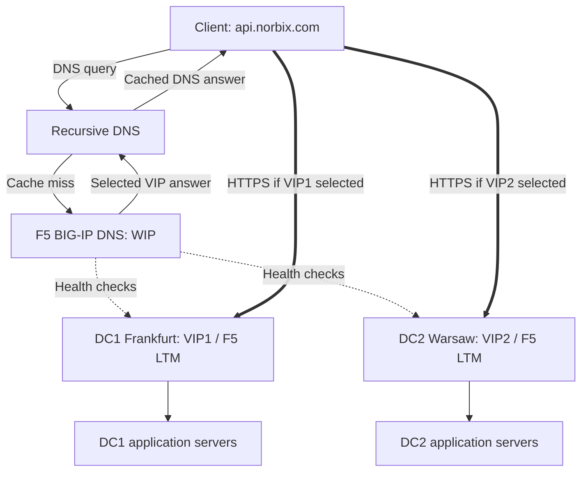
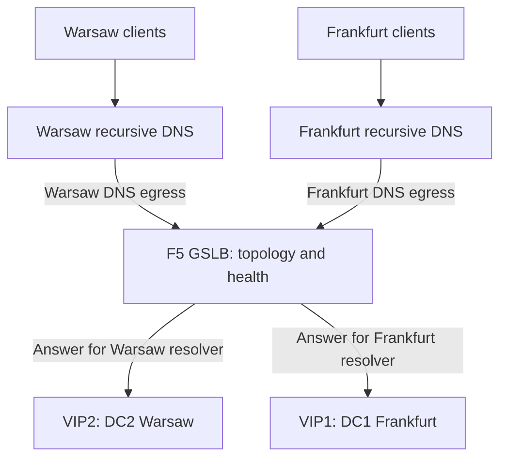
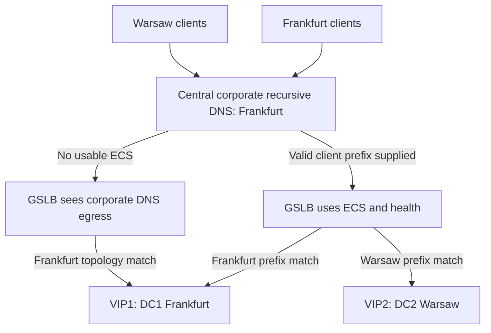

+++
date = '2025-11-26T10:00:00+02:00'
lastmod = '2026-11-07T13:00:00+01:00'
draft = false
title = 'WIP vs VIP in Load Balancing: Understanding Global vs Local Traffic Routing'
tags = ["networking", "load-balancing", "F5", "nginx", "infrastructure", "architecture", "DNS", "ECS", "GSLB"]
categories = ["software-engineering", "infrastructure", "networking"]
summary = "Understand WIP vs VIP, recursive and corporate DNS, ECS, and the limits of geolocation routing—with practical macOS dig tests."
comments = true
ShowToc = true
TocOpen = true
image = "banner.jpg"
weight = 30
+++


# WIP vs VIP in Load Balancing and Reverse Proxies: Understanding the Difference with F5 and NGINX

In modern distributed systems, the reliability of network traffic is as important as the reliability of the application code itself. High-traffic SaaS, global APIs, and distributed microservices rely on load balancers and reverse proxies to deliver low latency, high availability, and fault-tolerant routing.

Two common concepts often confused in this space are WIP (Wide IP) and VIP (Virtual IP). Although both deal with traffic routing, they operate at different layers, solve different problems, and are used in very different places.

This article breaks down `WIP` vs `VIP`, explains where each belongs in the network stack, and illustrates both with practical examples using F5 BIG-IP GTM (DNS Load Balancing) and NGINX (L4/L7 Reverse Proxy).

---

## 🧭 What is a VIP (Virtual IP)?

A VIP (Virtual IP) is an IP address that does not belong to a single physical server but instead represents a load-balanced endpoint. Clients send traffic to this virtual address, and the load balancer (L4 or L7) routes it to the appropriate backend instance.

VIPs operate within a local traffic context — typically inside a data center, Kubernetes cluster, VPC, availability zone, or cloud environment.

### ✔ Key Characteristics of a VIP

- Represents a service in a data center, VPC, or cluster; it may be public or private

- Backed by one or more real servers / pods / nodes

- Assigned to a reverse proxy / L4 or L7 load balancer

- Does not involve DNS-level traffic steering

- Handles high throughput and low latency traffic routing

- Usually tied to services that must be highly available within a region or network

### ✔ Example: NGINX VIP

When NGINX or NGINX Plus is used as a load balancer, you commonly configure something like:

```nginx
upstream api_backend {
    server 10.0.1.11;
    server 10.0.1.12;
    server 10.0.1.13;
}

server {
    listen 10.0.10.50:80;
    server_name api.internal.local;
    location / {
        proxy_pass http://api_backend;
    }
}
```

Here:

- The reverse proxy exposes a VIP (e.g., 10.0.10.50)

- Requests to that VIP are distributed to real servers

- Failures are handled internally by NGINX

- This ensures high SLA inside the local environment

A VIP provides a stable entry point. Its availability still depends on the load balancer, backend health, and the surrounding network. This example uses plain HTTP; a production HTTPS listener also needs TLS configuration.

In short:

**VIP = Layer 4/7 local load balancing of traffic to backend servers.**

## 🗺️ What is a WIP (Wide IP)?

A WIP (Wide IP) is a much broader concept, used in Global Traffic Management (GTM).
A Wide IP is a DNS-level construct that maps a domain name to multiple possible data centers, regions, or global endpoints, based on real-time health and load information.

WIP operates at a global level — across geographic regions, clouds, or HA data centers.

### ✔ Key Characteristics of a WIP

- Part of a Global Server Load Balancing (GSLB) system

- Sits at the DNS layer, not at L4 or L7

- Routes clients to the nearest / healthiest region

- Can steer traffic globally based on:

    - latency
    
    - geolocation
    
    - health checks
    
    - load / capacity

    - active-active or active-passive failover

- Used for global apps, multi-region SaaS, disaster recovery

- Does not itself forward HTTP/TCP packets — it returns DNS answers

### ✔ Example: F5 DNS (GTM) WIP

F5 BIG-IP DNS (formerly GTM) can define:

- A WIP: api.example.com

- Multiple "pools": e.g., EU region, US region, APAC region

- Each pool has multiple VIPs (local data center load balancers)

A possible configuration:

| Wide IP | Pool | Example VIP |
|---|---|---|
| `api.example.com` | US | `192.0.2.10` |
| `api.example.com` | EU | `198.51.100.10` |
| `api.example.com` | APAC | `203.0.113.10` |

These addresses are reserved for documentation. The deployed service needs real reachable addresses.


When a client resolves api.example.com, the WIP decides which region’s VIP should be returned.

The WIP does global DNS-level routing.
The VIP handles local load balancing for the chosen region.

## 🌍 CNAME Records and Global DNS Routing

A CNAME maps one DNS name to another:

```dns
api.example.com.  300  IN  CNAME  api.glb.example.net.
```

The recursive resolver follows that alias and asks the authoritative DNS service for `api.glb.example.net`. That service can choose a healthy regional VIP and return an A or AAAA answer.

**A CNAME is an alias, not a health checker or geolocation engine.** The GSLB service makes the routing decision. A CNAME is useful for keeping the public application name separate from the traffic-management namespace, but it is optional: the public name can also be managed directly by the authoritative GSLB service.

Some designs return region-specific CNAMEs; others return the selected VIP directly. Both can implement global traffic steering.

| Component | Responsibility |
|---|---|
| Public application name | Stable name used by clients |
| Optional CNAME | Alias to a traffic-management name |
| Authoritative GSLB DNS | Selects an answer using health and routing policy |
| Recursive resolver | Retrieves and caches DNS answers |
| Regional VIP | Accepts application connections and balances local traffic |

After resolution, the client connects to the selected VIP. HTTP traffic does not pass through the DNS server.

## 🏗️ Architecture: Global DNS and Regional Traffic

The diagrams below reconstruct the two-data-center architecture discussed above. They separate DNS resolution from application traffic: GSLB returns an address; the client then connects directly to that VIP.

### Global Selection and Local Load Balancing



The HTTPS arrows are alternatives: a connection targets the address selected by DNS. Health checks and policy determine which answers are eligible. The WIP does not forward the HTTPS connection.

### Local Recursive DNS per Location

This topology assumes each resolver's outbound DNS traffic exits near its users, and that the GeoIP data and topology rules map those addresses correctly.



Arrows from GSLB to VIP boxes show **answer selection**, not application traffic. Without ECS, location is inferred from recursive egress. A local forwarder pointing to central corporate DNS does not satisfy this local-recursion assumption.

### Central Corporate DNS: With and Without ECS



These are alternative behaviors, not two simultaneous queries. Without ECS, both offices can receive the Frankfurt answer. With usable branch-specific prefixes and matching topology rules, GSLB can distinguish them. Enabling ECS centrally is insufficient unless the resolver actually knows and forwards a meaningful prefix for each branch.

For **active–passive Global Availability**, replace the geographic preference with an ordered health policy: prefer VIP1, then use VIP2 when VIP1 is unavailable. In that policy, resolver location and ECS do not determine the preferred data center.

## 🧭 Whose Location Does GeoDNS Actually See?

When a laptop resolves a name, it normally uses a **recursive resolver**. That resolver follows DNS delegations, or forwards the request to another recursive service, and caches the result. The authoritative server publishes answers for the domain; it does not normally receive the laptop's query directly.

Without usable ECS information, the authoritative GSLB service sees the source IP of the resolver that contacts it. That address can differ from the DNS server address configured on the laptop.

### Local Recursive DNS and ISP DNS

A router at `192.168.1.1` may be only a DNS forwarder. If it sends requests to an ISP resolver, the authoritative service sees the ISP resolver's outbound address. If a local resolver performs recursion itself, the authoritative service generally sees the site's public DNS egress address after NAT.

An ISP resolver may provide a useful regional signal when its egress is close to its users. A nearby DNS listener, however, does not prove that recursion also exits nearby.

### Central Corporate DNS

Consider an employee in Warsaw whose queries go through corporate DNS infrastructure in Frankfurt. Without usable ECS, GSLB may classify the request using the corporate resolver's Frankfurt egress, rather than the employee's location.

The mismatch can be larger when offices on several continents share one central recursive service. A branch-local forwarder still provides a central location signal if it forwards everything to headquarters.

Corporate VPNs and VDI add another consideration: DNS resolution and application traffic may leave through different locations. For a browser running inside a remote VDI, the relevant application source is usually that remote environment, not the employee's laptop.

**Design routing around the application traffic's actual network path.** The user's physical location alone may be the wrong target.

## 📍 ECS: EDNS Client Subnet

EDNS Client Subnet (ECS), described in [RFC 7871](https://www.rfc-editor.org/rfc/rfc7871.html), lets a recursive resolver include a client network prefix in a query to an authoritative server. It can give GeoDNS a more useful location signal than a distant resolver's address.

For example, a resolver may send a truncated public client prefix rather than a complete address. RFC 7871 discusses `/24` for IPv4 and `/56` for IPv6 as privacy-oriented truncation recommendations; actual provider policies vary. ECS identifies a network, not a GPS position or an individual device.

ECS needs cooperation across the DNS path. A forwarder may remove it, a recursive service may restrict which authoritative destinations receive it, and the authoritative service must implement and use it correctly. A central corporate resolver cannot recover a branch's public location simply from a private address such as `10.0.0.20` without additional topology knowledge.

Google Public DNS supports ECS and detects authoritative ECS support. Its [implementation guidelines](https://developers.google.com/speed/public-dns/docs/ecs) explain why consistent responses and correct cache scopes matter. Support does not mean that ECS is sent to every destination on every query.

### Source Prefix and Scope Prefix

A `dig` response may contain:

```text
CLIENT-SUBNET: 198.51.100.0/24/0
```

| Part | Meaning |
|---|---|
| `198.51.100.0` | Network address carried in ECS |
| `/24` | Source prefix length: how much client network information was supplied |
| Final `/0` | Response scope: the answer is not restricted to a particular client subnet for caching |

The final `/0` does **not** mean that ECS was stripped or never forwarded. Likewise, seeing an ECS option in the response does not prove how the recursive resolver communicated with every upstream authority.

A query with `+subnet=0.0.0.0/0` supplies zero client address bits and requests that the resolver not add client address information upstream. This differs from simply omitting `+subnet`: the resolver may automatically add ECS to an ordinary query according to its policy.

ECS can improve endpoint selection when DNS and client locations differ. It also exposes some client network information and partitions DNS caches. Whether it improves latency must be measured; it does not directly increase bandwidth or change the Internet route to a fixed destination.

## 🌐 How Accurate Is GeoDNS Through Public Recursive DNS?

**Public recursive DNS services, such as Google Public DNS (`8.8.8.8`), can affect the location signal available to GeoDNS.** There is no universal accuracy percentage: country, region, and city accuracy are different questions, and none guarantees the lowest network latency. Providers differ in their recursive egress topology and ECS policies; the Google-specific details below are an example, not a rule for every public resolver.

`8.8.8.8` is Google's anycast service address. A query from Poland does not automatically travel to the United States because an IP database associates that address with Google. Network routing selects an anycast service location, and the address used for outbound recursion can be different again.

Google documents both its anycast service and the [outbound resolver ranges and location feeds](https://developers.google.com/speed/public-dns/faq#locations). Those outbound locations are useful signals when ECS is absent, but are not proof of the end user's location.

| DNS path | Location signal available to GSLB | Practical limit |
|---|---|---|
| Site-local recursion without ECS | Site's public DNS egress | Depends on NAT, routing, and GeoIP data |
| ISP recursion without ECS | ISP resolver's outbound address | ISP may centralize recursion |
| Central corporate DNS without ECS | Corporate DNS egress | Multiple offices can appear to be one location |
| Public recursive DNS without usable ECS, such as Google Public DNS (`8.8.8.8`) | Provider's outbound recursive address | Ingress and recursive egress can differ; topology varies by provider |
| ECS-aware recursion and authority | Client network prefix | Still affected by prefix accuracy, VPNs, caches, and policy |

Public DNS can provide good regional steering, particularly with usable ECS. It cannot guarantee city-level precision or the best-performing VIP for every user. Validate the selected VIP and actual connection latency from representative ISPs, offices, VPNs, and regions. A geographically closer data center may have a worse network path.

## 🛠️ Hands-On: Our macOS `dig` Investigation

The following observations come from a macOS session on **6 November 2026**. They describe that test, not a permanent guarantee of the ISP's configuration. Abridged output below preserves only the relevant fields.

### 1. Inspect the Configured Resolvers

```bash
cat /etc/resolv.conf
```

The file listed:

```text
nameserver 45.131.35.6
nameserver 45.131.35.7
```

On macOS, `/etc/resolv.conf` does not describe every scoped or VPN-specific resolver used by native applications. For a fuller view, use:

```bash
scutil --dns
```

An explicit `dig @SERVER` tests that server directly. It does not necessarily reproduce a browser's DNS path, especially with VPN split DNS or browser DNS over HTTPS.

### 2. Observe the Resolver's Outbound Address

We ran both:

```bash
dig @45.131.35.6 TXT o-o.myaddr.l.google.com +short
dig TXT o-o.myaddr.l.google.com +short
```

Both returned:

```text
"45.131.35.5"
```

For these lookups, Google's diagnostic service reported `45.131.35.5` as the upstream query source. We queried a listener at `.6`, but the diagnostic answer identified `.5`. This is consistent with separate listener and recursive egress addresses, potentially involving NAT or an upstream resolver. The result alone does not reveal the ISP's internal topology or the device's public IP.

### 3. Request a Zero-Length ECS Prefix

```bash
dig @45.131.35.6 google.com A +subnet=0.0.0.0/0
```

Relevant observed fields:

```text
CLIENT-SUBNET: 0.0.0.0/0/0
SERVER: 45.131.35.6#53
```

The answer included `142.251.98.139`. Google addresses change, so this is a historical observation rather than an expected test value.

We also queried the diagnostic name:

```bash
dig @45.131.35.6 TXT o-o.myaddr.l.google.com +subnet=0.0.0.0/0
```

Relevant response content:

```text
CLIENT-SUBNET: 0.0.0.0/0/0
"45.131.35.5"
```

These responses show a zero-length ECS option on the client-facing response. They do not establish whether the ISP automatically attaches ECS to normal queries that omit this option.

### 4. Supply a Documentation Prefix

```bash
dig @45.131.35.6 TXT o-o.myaddr.l.google.com +subnet=198.51.100.0/24
```

The recorded ECS response field was:

```text
CLIENT-SUBNET: 198.51.100.0/24/0
```

`198.51.100.0/24` is reserved for documentation. It was a synthetic protocol probe, not our real network prefix and not evidence of any country's routing behavior.

This demonstrated an ECS-bearing response to that query. It did **not** prove that arbitrary supplied prefixes reach every authority, that automatic ECS forwarding is enabled, or that GeoDNS will select a different VIP.

### What the Tests Established

| Observation | Supported conclusion | Still unverified |
|---|---|---|
| Queries sent to `.6`, diagnostic answer reported `.5` | Listener and observed upstream source differed | Exact internal forwarding or NAT topology |
| `/0` option returned | Zero-length ECS appeared in this response | Automatic ECS behavior without an explicit option |
| Synthetic `/24` option returned | This query received an ECS-bearing response | End-to-end forwarding and use for the target application |

To confirm the remaining behavior, ask the ISP whether it adds ECS by default, which destinations receive it, and what prefix lengths it uses. For a definitive application-specific test, inspect query logs or packet captures at an authoritative server you control.

### Further Comparisons to Run

These are suggested follow-up commands, **not results from the recorded session**. Replace `api.example.com` with the real public service name:

```bash
# Compare ISP DNS with a public recursive resolver (Google Public DNS here).
# Inspect the ordinary answers and their remaining TTLs.
dig @45.131.35.6 api.example.com A +noall +answer
dig @8.8.8.8 api.example.com A +noall +answer

# Repeat for IPv6 when the application publishes AAAA records.
dig @8.8.8.8 api.example.com AAAA +noall +answer

# Inspect full EDNS/ECS output rather than hiding it with +short.
dig @8.8.8.8 api.example.com A
dig @8.8.8.8 api.example.com A +subnet=0.0.0.0/0
```

Matching answers do not prove that ECS is absent: both locations may map to the same healthy region, or the policy may be active–passive. Different answers do not prove ECS caused the difference: caches, load distribution, health, and resolver location can also affect selection.

`dig` query time measures DNS lookup time, not application latency. Measure connection time and request latency to the selected endpoints separately.

## 🔁 Active–Passive Failover Does Not Require Geolocation

For a service with VIP1 in DC1 and VIP2 in DC2, the policy can simply prefer DC1 and use DC2 when DC1 is unhealthy. There is no need to infer the user's location for that decision.

F5's **Global Availability** method selects the first available resource in an ordered list. With suitable health monitors and pool configuration, it can implement this active–passive policy. Other authoritative DNS/GSLB products can implement equivalent policies; ECS is not specific to F5.

A low TTL helps new resolutions pick up changed answers sooner, but failover is not instantaneous. Health-check detection, cached CNAME and A/AAAA records, client caching, retries, and existing connections all affect recovery. DNS changes do not migrate established TCP connections.

## ⚖️ WIP vs VIP: What’s the Difference?

| Feature | WIP (Wide IP) | VIP (Virtual IP) |
|---------|---------------|-------------------|
| Layer | DNS application protocol (over UDP/TCP or encrypted transports) | Network/Transport/Application (L4/L7) |
| Purpose | Route globally between regions | Balance traffic locally inside a region |
| Example | F5 BIG-IP DNS / GTM | NGINX, HAProxy, Envoy |
| Redirect Type | DNS answer selection | TCP/HTTP forwarding |
| Health Checks | Regional / data center | Individual nodes/pods |
| Typical Use Case | Multi-region SaaS, DR | Service load balancing |
| SLA Impact | Multi-region availability | Intra-region availability |

In plain terms:

- `VIP`: balances traffic between servers inside one region or cluster

- `WIP`: balances traffic between regions or between VIPs

Both contribute to overall SLA, but at different layers of your architecture.


## 🔐 How `WIP` + `VIP` Work Together for High SLA

A modern globally resilient architecture often uses this pattern:

1. Global DNS steering (WIP with F5 BIG-IP DNS)

   - Checks health of entire regions

   - Fails over between EU/US/APAC

   - Can apply geolocation for active–active routing, or ordered failover for active–passive routing

1. Local High Availability (VIP with NGINX or LB)

   - Balances traffic between replica pods / nodes

   - Automatically removes unhealthy instances

   - Provides L7 routing logic (path, headers, rate limits)

   - Combined, they create a multi-layer failover strategy:

    DNS first selects a regional VIP; the client then connects to that VIP, which forwards traffic to local services.

    This ensures:

   - Global failover (if EU goes down → steer to US)

   - Local failover (remove a failed pod after health checks detect it)

   - High availability across the entire stack

   - Actual SLA depends on application resilience, data replication, network dependencies, and tested recovery behavior.


## 🚀 Summary

`WIP` (Wide IP) and VIP (Virtual IP) solve different parts of the traffic-routing problem:

`WIP` = DNS-level global traffic steering (F5 GTM)

`VIP` = L4/L7 local load balancing (NGINX)

Using both creates a powerful, multi-layered reliability strategy for modern SaaS and distributed systems.

For multi-region platforms, global DNS steering and regional load balancing can complement each other. Successful routing depends on health signals, the recursive DNS path, caching, and the location information actually available to the authoritative service.

## References

- [RFC 7871: Client Subnet in DNS Queries](https://www.rfc-editor.org/rfc/rfc7871.html) — ECS semantics, cache scope, forwarding, and privacy.
- [Google Public DNS: ECS Guidelines](https://developers.google.com/speed/public-dns/docs/ecs) — authoritative support detection and deployment requirements.
- [Google Public DNS FAQ](https://developers.google.com/speed/public-dns/faq) — anycast and outbound recursive server locations.
- [F5: About Load Balancing and Resource Availability](https://techdocs.f5.com/en-us/bigip-15-0-0/big-ip-dns-load-balancing/about-load-balancing-and-resource-availability.html) — Global Availability and health-based selection.

---

🚀 Follow me on [norbix.dev](https://norbix.dev) for more insights on Go, Python, AI, system design, and engineering wisdom.
